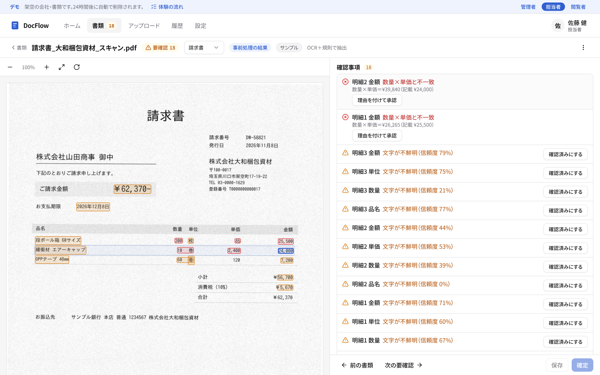
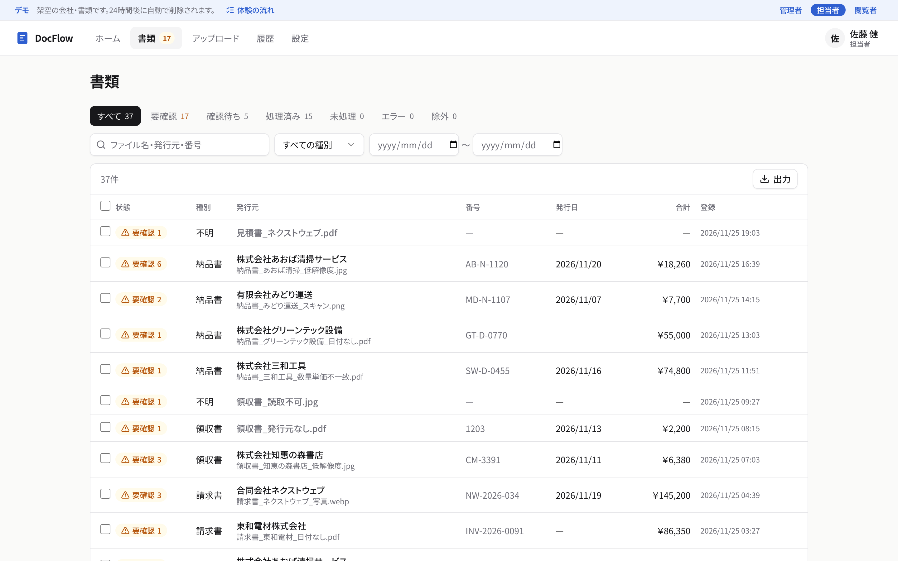
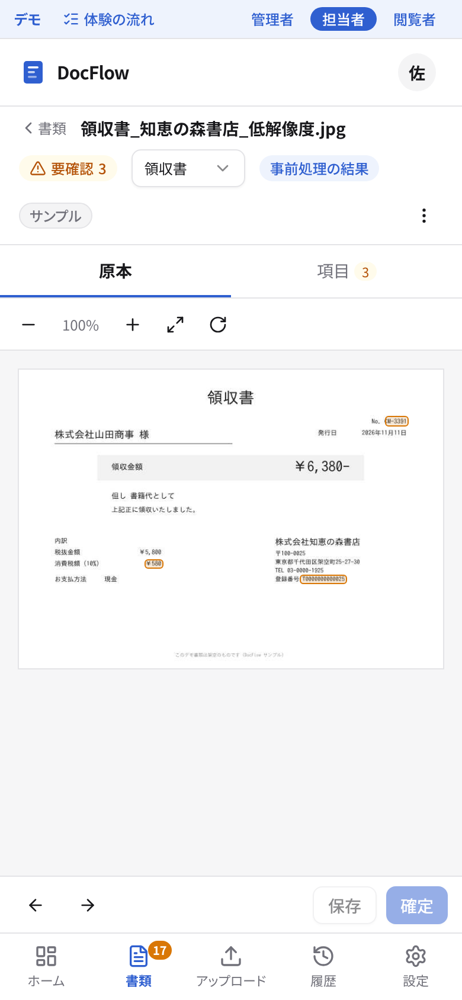
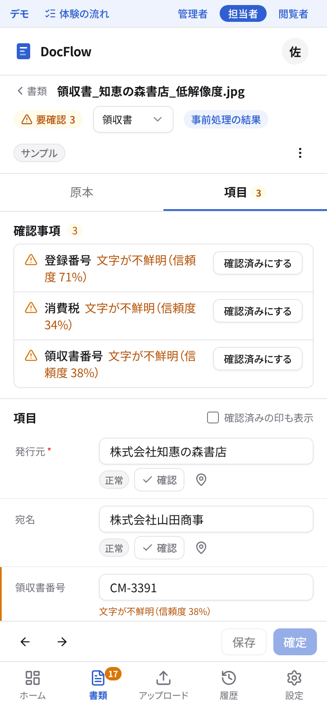

# DocFlow — AI帳票・書類処理システム

中小企業向けの、請求書・領収書・納品書の処理システムです。PDF やスキャン画像から項目を読み取り、**自信のない項目だけ**を原本の上に示して人が確認し、確定した値だけを Excel・CSV に出力します。

> ポートフォリオ作品です。デモに出てくる会社（株式会社山田商事）・取引先・書類・数値はすべて架空です。

**公開中のデモ**：https://docflow-mu-beige.vercel.app （「デモを試す」から登録なしで試せます）



| 書類の一覧 | スマートフォン（原本） | スマートフォン（項目） |
| --- | --- | --- |
|  |  |  |

## できること

| 画面 | 内容 |
| --- | --- |
| ホーム | 未処理・要確認・処理済み・今月処理の件数、要確認の書類（確認事項の多い順）、最近の書類 |
| 書類 | 状態のタブ（要確認・確認待ち・処理済み・未処理・エラー・除外）、検索（ファイル名・発行元・番号）、種別・発行日の絞り込み、まとめて出力 |
| アップロード | 複数ファイル（PDF・PNG・JPEG・WebP）。1件ずつ送って、読み取りの進み具合を表示。同じファイルは知らせる（自動で消さない） |
| 確認画面 | 左に原本（拡大・縮小・回転・ページ送り）、右に確認事項・項目・明細・金額の照合・読み取りの情報・履歴。項目を押すと原本の位置、原本の印を押すと項目へ。修正・確認・承認・保存・確定・再確認 |
| 履歴 | 確定・修正・承認・重複の判断・アップロード・設定の変更（管理者のみ）、出力の記録 |
| 設定 | ファイルの上限・要確認にする信頼度・担当者が確定できる金額・外部の AI の利用、メンバーと役割、今月の読み取りの利用量、書類の取り扱い |
| 紹介ページ | 課題・解決・導入前後の比較・導入効果の試算（架空企業のシミュレーション）・実測の精度 |

### 読み取りの流れ

1. **原本の確認**：形式（中身で判定）・大きさ・ページ数。スクリプトや添付ファイルを含む PDF、パスワード付き・壊れた PDF、展開すると大きすぎる画像は受け付けません。
2. **文字と位置**：文字情報のある PDF はその文字と座標を使い、画像・スキャン PDF は OCR（Tesseract・日本語、サーバー内）で読みます。
3. **種別の判定**：見出し・語句の点数で請求書・領収書・納品書を判定。決まらなければ「不明」（利用者が選ぶと読み直します）。
4. **項目の抽出**：ラベルと位置の規則で取り出します（外部の AI を有効にした組織では AI も使用。下記）。**読み取れない項目は空欄（未取得）のままにし、推測で埋めません。**
5. **検証**：必須項目・形式・日付・OCR の信頼度・金額の照合（明細の合計＝小計、数量×単価＝金額、小計＋税＝合計、税率ごとの税額）・同じ書類の疑い。
6. **人の確認**：確認事項を解消して「確定」すると、その時点の値を記録し「処理済み」にします。**自動では確定しません。**

### 確認画面のルール

| 状態 | 原本の印 | 意味 |
| --- | --- | --- |
| 正常 | なし（押せる） | 検証に問題なし |
| 要確認 | 黄 | 信頼度が低い・形式が怪しい・候補が複数 など |
| 不整合 | 赤 | 金額が合わない・必須項目がない など |
| 確認済み | 緑（「確認済みの印も表示」をオンにしたとき） | 人が原本と見比べた |
| 未取得 | なし | 読み取れなかった（空欄） |
| 選択中 | 青い枠 | いま選んでいる項目（明細は行全体も薄く示す） |

- 原本の位置が分からない項目には印を出しません（間違った位置に出さない）。「原本の位置を特定できないため、印を付けていません」と知らせます。
- 値を直しただけでは確認済みになりません。「確認」を押したときだけ確認済みになり、確認済みの値を直すと未確認に戻ります。
- 金額の不一致などは、値を直すか、**理由を付けて承認**すると解消します。承認した後に関係する値が変わると、もう一度確認が要ります。
- 保存は版番号付きで、ほかの人が先に更新していれば上書きせずに知らせます。保存していない変更があるときは、画面を離れる前に確かめます。

### 役割

| | 管理者 | 担当者 | 閲覧者 |
| --- | --- | --- | --- |
| 閲覧・原本の表示 | ○ | ○ | ○ |
| アップロード・読み直し・修正・確定・出力 | ○ | ○（確定は設定の金額まで） | − |
| 削除・設定・メンバー | ○ | − | − |

画面の表示だけでなく、サーバーの処理と DB の関数・RLS でも同じ制限をかけています。

## 外部の AI と OCR（任意）

| | 既定 | 切り替え |
| --- | --- | --- |
| OCR | Tesseract（tesseract.js・日本語の学習データ）。**このシステムのサーバー内で読む**。外部に送らない | `OCR_PROVIDER=google-document-ai`（Google Cloud の課金設定とサービスアカウントが必要） |
| 項目の抽出 | 規則（ラベルと位置）。外部に送らない | `ANTHROPIC_API_KEY` と `LLM_MODEL` を設定し、管理者が設定画面で「外部の AI」をオン |

外部の AI を使うときの守り：

- 送るのは**読み取った文字と位置だけ**で、画像は送りません。口座番号・電話番号は伏せて送ります（`LLM_MASK_SENSITIVE`）。
- 書類の文字は「データ」として渡し、書類の中の指示には従わないよう指定しています（プロンプトインジェクション対策）。出力は JSON の形を検証します。
- AI が返した値は、**原本の文字の中に根拠が見つかるものだけ**を使います。根拠が見つからない値・原本と食い違う値は捨てて「未取得」にし、その件数を読み取りの情報に残します。
- デモ環境（訪問者ごと）では、API キーがあっても外部の AI は使いません（DB の関数でも禁止）。
- AI が失敗したときは規則の抽出に切り替えます（`LLM_FALLBACK_TO_RULES`）。利用量（回数・ページ・トークン）は設定画面に表示します。
- API キーはサーバーの環境変数だけに置き、ブラウザには送りません。

> この環境では Anthropic の API と Google Document AI を実際には呼び出して確認していません（キーが無いため）。AI の部分は、模擬の応答を使った単体テストで「根拠のない値を捨てる」「失敗したら規則に切り替える」「口座番号を伏せる」などを確かめています。

## 精度（実測）

架空のデモ書類 37 件（文字情報のある PDF 26 件・スキャン画像など 11 件）を、規則の抽出（AI 不使用）で読み取った結果です。詳しくは [docs/ACCURACY.md](docs/ACCURACY.md)（`npm run demo:evaluate` で作り直せます）。

| 指標 | 結果 |
| --- | --- |
| 文字情報のある PDF の見出し項目 | 220 / 220（100%） |
| スキャン画像・写真の見出し項目 | 85 / 99（ピンぼけで読めない画像 1 件・10 項目を含む） |
| 全体の見出し項目 | 305 / 319（95.6%）・誤り 3・未取得 11 |
| 誤った項目のうち「要確認」「不整合」として示した数 | 2 / 3（残りの 1 件は「知恵」を異体字の「知惠」と読んだもの） |
| 明細の値（品名・数量・単位・単価・金額） | 560 / 575（97.4%） |
| 印字されていない項目に値を入れた件数（推測） | 0 |
| 書類種別の判定 | 36 / 37 |

実際の取引先の書類での精度を示すものではありません。低解像度のスキャン画像では誤りが増えるため、どの書類も人が確定するまで「処理済み」にしません。

## デモ

- 「デモを試す」で、訪問者ごとに**専用のデモ会社**（架空の書類 37 件）を作ってログインします。ほかの訪問者の操作は見えません。24時間後に自動で削除され、メニューの「デモデータを初期化」で最初の状態に戻せます。
- デモの書類は**事前に処理した結果**を読み込んでいます（画面に「事前処理の結果」と表示）。その結果は、このリポジトリの読み取り処理（`npm run demo:process`）で実際に作ったものです。デモでアップロードした書類は、その場で読み取ります。
- 役割（管理者・担当者・閲覧者）は上の帯から切り替えられます。
- 3〜5分の流れ：要確認の書類を開く → 確認事項を押して原本の位置を見る → 値を直して「確認」→ 確定 → Excel・CSV に出力 → 自分でアップロード（サンプルの書類はアップロード画面からダウンロードできます）。

## 使っている技術

| | |
| --- | --- |
| 画面・サーバー | Next.js 16（App Router・Server Actions）、React 19、TypeScript、Tailwind CSS 4、Radix UI、react-hook-form＋zod |
| データベース | PostgreSQL（Neon。Supabase でも可）。postgres.js で接続し、トランザクションごとに `authenticated` ロールと利用者の情報を設定して RLS を効かせる |
| 業務ロジック | 書類・項目・検証結果の書き込みは `security definer` の DB 関数だけ（利用者は表に直接書き込めない） |
| 読み取り | pdf.js（文字と座標・ページの画像化）、tesseract.js（OCR）、sharp（画像の確認・変換）、Anthropic SDK（任意） |
| 出力 | ExcelJS（種別ごとのシート＋明細）、CSV（UTF-8・BOM 付き）。数式として解釈される値は無害化 |
| テスト | Vitest（単体・DB）、Playwright（PC・スマートフォンの E2E） |
| 公開 | Vercel ＋ Neon |

設計の詳細は [docs/DESIGN.md](docs/DESIGN.md)、公開の手順は [docs/DEPLOY.md](docs/DEPLOY.md) を参照してください。

## ローカルで動かす

必要なもの：Node.js 22、PostgreSQL 16（`postgres` / `postgres` で接続できること）

```bash
npm ci
cp .env.example .env.local          # 中身はそのままで動きます（外部の AI・OCR は使いません）
npm run db:local:reset              # DB「docflow」を作り直してマイグレーションを適用
npm run db:seed                     # 見本の会社とデモの元データを投入
npm run dev                         # http://localhost:3000
```

- 「デモを試す」でそのまま使えます。
- 見本の会社には `admin@docflow.example` / `staff@docflow.example` / `viewer@docflow.example`、パスワード `docflow-demo-2026`（ローカル専用。公開環境では使えません）でもログインできます。

## テスト

```bash
npm run typecheck && npm run lint
npm run test:unit      # 単体：座標の変換（回転・拡大）・値の正規化・金額の照合・検証・重複・読み取りの回帰・AI の模擬・出力・悪意のあるファイル
npm run test:db        # DB：組織ごとの分離（RLS）・役割の権限・確定の条件・版番号・管理者の保護・デモの制限・処理のキュー
npm run test:e2e       # ブラウザ：確認して確定・金額の不一致の承認・修正だけでは確認済みにならない・閲覧者・アップロード・出力・スマートフォン
```

DB テストはテスト専用のデータベース（`docflow_test`）を作り直して使います。E2E はローカルの DB（`npm run db:local:reset && npm run db:seed` の後）を使います。GitHub Actions（`.github/workflows/ci.yml`）でも同じものを実行します。

## 仕様からの変更点・できていないこと

- **ログインは Supabase Auth ではなく、アプリ内のログイン**（`app_auth` スキーマ、scrypt でハッシュ化したパスワードと HttpOnly Cookie のセッション）です。訪問者ごとのデモ会社を作って即ログインさせる仕組みを、外部サービスの設定なしで確実に動かすためです。RLS は Supabase と同じ `auth.uid()`・`authenticated` ロールの形で書いているので、Supabase Auth へ移すときもポリシーは変えずに済みます。
- **ファイルの保存先は、既定で DB の非公開の表**（`app_private.file_blobs`。利用者の権限では読めず、組織を確かめてからサーバーが返す）です。`SUPABASE_URL` と `SUPABASE_SERVICE_ROLE_KEY` を設定すると Supabase Storage の非公開バケットに保存します。
- Vercel では1回の送信が 4.5MB までのため、公開環境の1ファイルの上限は 4MB です（`UPLOAD_BODY_LIMIT_MB`）。
- 読み取りは手書き・縦書き・表の罫線の解析には対応していません。会計ソフト固有の出力形式（弥生・freee など）は未対応で、DocFlow の標準の列で出力します。
- 外部の AI（Anthropic）と Google Document AI は、この開発環境では実際の呼び出しを確認していません（上記）。

## ディレクトリ

```
src/app/(public)        紹介ページ・ログイン
src/app/(app)           ログイン後の画面（ホーム・書類・確認画面・アップロード・履歴・設定）
src/app/api             アップロード・状態の確認・原本の表示・出力・定期処理
src/components/review   確認画面（原本の表示・印・項目・確認事項）
src/lib/extraction      読み取り（PDF・OCR・種別の判定・項目の抽出・AI）
src/lib/validation      検証（金額の照合・信頼度・重複）
src/lib/jobs            読み取りの処理のキュー
src/lib/actions         Server Actions（入力検証 → DB 関数）
src/lib/demo            デモの元データ・訪問者ごとのデモ
supabase/migrations     テーブル・DB 関数・RLS
demo/                   架空のデモ書類・正解・事前処理の結果
tests/{unit,db,e2e}     テスト
```
